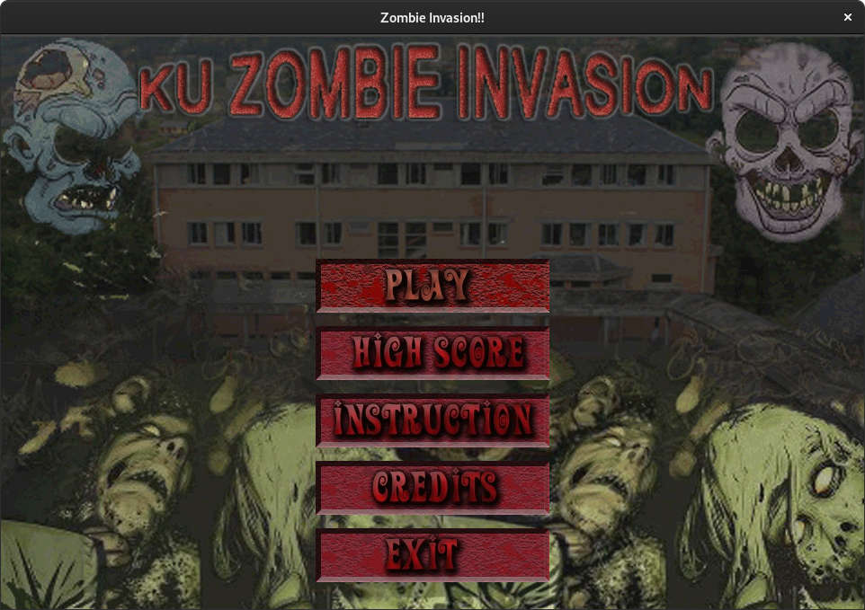

# KU-Zombie-Invasion

Kathmandu University is under a Zombie attack! Survive the apocalypse and claim your classrooms back!

Bullets are important resources. Time is critical. [Double tap](https://www.youtube.com/watch?v=w4sWxsrEFFs&ab_channel=ALTERIAN%2CINC.) whenever possible. Shoot and kill all zombies in the classroom to overcome the invasion, save your university and [~~don't~~ be a hero](https://www.youtube.com/watch?v=n3yaZ-pjR2M&ab_channel=An01dGr4ndma).



## Play in the browser

The game has a plain JavaScript web version ([index.html](index.html) + [game.js](game.js)) that uses the same images and sounds. No build step or dependencies.

```
$ make web        # serves the game at http://localhost:8000
```

You can also open `index.html` directly in a browser, or host the repository on any static host (e.g. GitHub Pages). High scores are saved in the browser's localStorage.

## Install and play (native SDL version)

Download [here](https://github.com/prtx/KU-Zombie-Invasion/raw/main/ku_zombie) or build from source

```
$ git clone https://github.com/prtx/KU-Zombie-Invasion
$ make install
$ make build
$ make play
```


FYI, My first undergrad project :)
